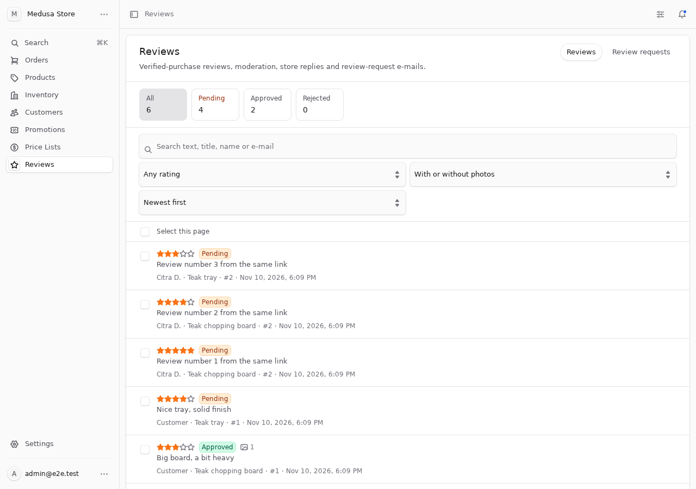
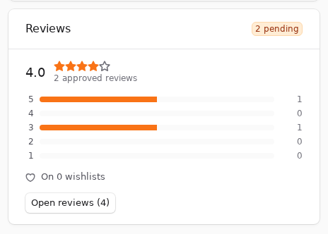

<p align="center">
  <a href="https://hauskayu.com">
    <picture>
      <source media="(prefers-color-scheme: dark)" srcset="docs/logo-dark.svg">
      
    </picture>
  </a>
</p>

# medusa-reviews-wishlist

**Product reviews with photos, verified purchase, moderation, review-request e-mails with magic links, JSON-LD,
and wishlists (customer + guest) in one Medusa v2 plugin.** Only people who bought and received a product can
review it, once per order item. There is no way to create or import fake reviews.
<br>Ulasan produk dengan foto, pembelian terverifikasi, moderasi, e-mail permintaan ulasan dengan magic link,
JSON-LD, dan wishlist (pelanggan + tamu) dalam satu plugin Medusa v2. Tidak ada fitur membuat ulasan palsu.

[](https://www.npmjs.com/package/medusa-reviews-wishlist)
[](https://github.com/haustex/sp-medusa-reviews-wishlist/actions/workflows/ci.yml)
[](https://medusajs.com)
[](LICENSE)

### Compatibility

| Plugin | Medusa | Node | Tested in CI on |
| --- | --- | --- | --- |
| 0.1.x | 2.19.0 or newer 2.x (`^2.19.0`) | 20.19+ or 22.12+ | Medusa 2.19.0 and 2.22.2 |

Needs a Notification Module provider for the `email` channel (Resend, SendGrid, your own…) to send review requests;
everything else works without one. Photos go through the File Module (local, S3, R2, …).

### Quick start

```bash
npm install medusa-reviews-wishlist
```

```ts
// medusa-config.ts
plugins: [
  {
    resolve: "medusa-reviews-wishlist",
    options: {
      review_requests: {
        trigger: "shipped",        // or "delivered" / "completed"
        delay_days: 7,
        link_url: "https://your-store.com/review/{token}",
        backend_url: "https://api.your-store.com",
      },
    },
  },
],
```

```bash
npx medusa db:migrate
```

Open **Reviews** in the Admin sidebar. Reviews arrive as *pending* (unless `auto_approve`), a bell notification
tells you, and the storefront reads `/store/reviews` and `/store/reviews/ratings`.
Full steps: [Installation](#installation) · [Options](#plugin-options) · [Storefront (Next.js)](#storefront-nextjs) ·
[Review-request e-mail](#review-request-e-mail) · [API](#store-api).

[English](#english) · [Bahasa Indonesia](#bahasa-indonesia)

| Moderation | Product page widget |
| --- | --- |
|  |  |

---

## English

### Features

**Reviews**

- Rating 1–5, title, text, up to N photos, locale. **Verified purchase only**: an item can be reviewed once it is
  shipped, delivered or completed (your choice), by the order's customer or through the order's magic link, **once
  per order item**. Reviews are tied to the line item in the database, so a second one is impossible.
- **Photos stay private until approved.** They are stored as private files while pending, published (copied to a
  public file) on approval and deleted on rejection. A pending review never has a public photo URL. File type is
  sniffed from the bytes, size and count are capped.
- **Moderation** in the Admin: pending / approved / rejected, reason, store reply shown publicly, filters (status,
  rating, photos, product, order, search), bulk approve / reject / delete, optional auto-approve, a bell (feed)
  notification for every new review, product and order page widgets.
- **Per-product aggregate** (average, count, 1–5 distribution) stored in its own table and updated by the
  workflows, so product listings read one row per product.
- **Events** for cache purging and integrations: `review.created`, `review.approved`, `review.rejected`,
  `review.deleted`, `review.replied`, `product_rating.updated`, `review_request.scheduled`, `review_request.sent`,
  `wishlist.item_added`, `wishlist.item_removed`, `wishlist.merged`.
- **JSON-LD helper** (`medusa-reviews-wishlist/jsonld`): `AggregateRating` and `Review` fragments from approved
  reviews only; nothing is padded or invented.
- **Anti-abuse**: rate limit per IP and route (Cache Module, i.e. Redis in production, in-memory fallback), honeypot
  field, minimum and maximum length, HTML stripped, plain text only.
- **Privacy**: the public name is shortened server-side ("Anto R.", initials or full, your choice); e-mail, customer
  id, order id and IP never leave the Store API; IPs are stored as salted hashes; deleting a customer anonymises
  (or deletes) their reviews and removes their requests, uploads and wishlist.
- **No fake reviews.** There is no endpoint, script or Admin button that creates a review without a purchase. A
  future import from another platform will carry a `source` label.

**Review-request e-mail**

- One e-mail per order, scheduled when the order reaches the trigger (`shipped`, `delivered` or `completed`) plus
  a delay, both overridable per region or sales channel. Sent by a job every 15 minutes through the Notification
  Module (`channel: "email"`, template name configurable) with all the data a template needs.
- **Magic link**, single e-mail, works without an account: opening it never consumes it (refresh, second device,
  come back tomorrow). It stays valid until every item of the order has a review, including items shipped later,
  or until it expires (30 days by default). Only a hash of the token is stored.
- **One-click unsubscribe** (CAN-SPAM): a signed link that works without login or publishable key; the opt-out is
  stored as an e-mail hash and later requests for that address are marked `opted_out`.
- Admin: list of requests with status, "send now" / "send a fresh link", schedule one for an order placed before
  the plugin was installed.

**Wishlist**

- For customers and **guests** (a token the storefront keeps; merged into the account on login), optional variant
  per item, optional **share link** (read-only, revocable), optional **per-product count** ("saved by 12 people").

**API & docs**

- Store API, Admin API, typed SDK helper (`medusa-reviews-wishlist/sdk`), Next.js examples below.

### Requirements

- Medusa 2.19.0 or newer 2.x, PostgreSQL, Redis recommended (events, cache for the rate limit).
- For review-request e-mails: a Notification Module provider on the `email` channel and a template with the name
  from `review_requests.template` (default `review-request`).
- For photos: the File Module (the default local provider works; S3/R2 for production).

### Installation

1. `npm install medusa-reviews-wishlist`
2. Add the plugin to `medusa-config.ts` (see [Quick start](#quick-start)) with at least `review_requests.link_url`
   (the storefront page that handles the magic link) and `review_requests.backend_url` (public URL of the backend,
   used in the unsubscribe link).
3. `npx medusa db:migrate` creates the tables (`review`, `review_image`, `review_reply`, `review_upload`,
   `review_request`, `review_opt_out`, `product_rating`, `wishlist`, `wishlist_item`, `product_wishlist_count`).
4. Restart. The jobs (`send-review-requests` every 15 min, `cleanup-review-uploads` daily) run on the worker.

### Plugin options

All optional. Defaults in brackets.

| Option | Meaning |
| --- | --- |
| `auto_approve` [`false`] | Publish new reviews without moderation. |
| `display_name` [`"short"`] | Public reviewer name: `short` ("Anto R."), `initials` ("A. R.") or `full`. |
| `reviews.min_body_length` [`10`], `max_body_length` [`2000`], `max_title_length` [`120`] | Text limits (characters, after sanitising). |
| `reviews.max_photos` [`3`], `max_photo_bytes` [`5 MiB`], `photo_types` [jpeg, png, webp, avif] | Photo limits. `max_photos: 0` disables photos. |
| `reviews.honeypot_field` [`"website"`] | Field that must be empty in the create request. |
| `reviews.max_page_size` [`50`] | Largest `limit` the Store API accepts. |
| `review_requests.enabled` [`true`] | Schedule and send review-request e-mails. |
| `review_requests.trigger` [`"delivered"`] | `shipped`, `delivered` or `completed`. Pick `shipped` if your orders rarely get marked delivered. |
| `review_requests.delay_days` [`7`] | Days after the trigger. |
| `review_requests.rules` [`[]`] | `[{ region_id?, sales_channel_id?, trigger?, delay_days? }]`, first match wins. |
| `review_requests.token_ttl_days` [`30`] | How long a magic link stays valid after sending. |
| `review_requests.template` [`"review-request"`] | Notification template name. |
| `review_requests.link_url` | Storefront URL with `{token}`, e.g. `https://shop.example/review/{token}`. **Required to send.** |
| `review_requests.backend_url` | Public backend URL for the unsubscribe link. |
| `review_requests.from` | Sender passed to the provider, if it supports one. |
| `review_requests.batch_size` [`100`] | Requests sent per job run. |
| `notify_admin_feed` [`true`] | Bell notification in the Admin for every new review. |
| `rate_limit.window_seconds` [`600`], `rate_limit.max` [`10`] | Per IP and route. `max: 0` disables. |
| `wishlist.guest` [`true`], `wishlist.share` [`true`], `wishlist.counts` [`false`], `wishlist.max_items` [`200`] | Wishlist features. |
| `privacy.on_customer_deleted` [`"anonymize"`] | `anonymize` keeps the reviews under "Customer"; `delete` removes them. |
| `privacy.ip_salt`, `secret` | Salt for the IP hash and key for unsubscribe links. Default: the project's `JWT_SECRET`. |
| `showCredit` [`false`] | Show a small "by Haus Kayu" line under the plugin's Admin pages. Off by default. |

### Storefront (Next.js)

The examples use `@medusajs/js-sdk` with the helpers from `medusa-reviews-wishlist/sdk`. Ratings and review lists
are public and cacheable; eligibility, creating and the wishlist need the customer session (or the guest token).

**Stars on a product card** (server component; one request for the whole grid)

```tsx
import Medusa from "@medusajs/js-sdk"
import { reviewsStore } from "medusa-reviews-wishlist/sdk"

const sdk = new Medusa({ baseUrl: process.env.MEDUSA_BACKEND_URL!, publishableKey: process.env.NEXT_PUBLIC_MEDUSA_PUBLISHABLE_KEY! })

export async function ProductGrid({ products }: { products: { id: string; title: string }[] }) {
  const { ratings } = await reviewsStore(sdk).ratings(products.map((p) => p.id))
  const byId = new Map(ratings.map((r) => [r.product_id, r]))
  return products.map((p) => {
    const r = byId.get(p.id)
    return (
      <article key={p.id}>
        <h3>{p.title}</h3>
        {r && r.count > 0 && (
          <p aria-label={`${r.average} out of 5`}>
            {"★".repeat(Math.round(r.average))}{"☆".repeat(5 - Math.round(r.average))} <small>({r.count})</small>
          </p>
        )}
      </article>
    )
  })
}
```

**Rating summary and review list on the product page** (server component, ISR friendly)

```tsx
import { reviewsStore } from "medusa-reviews-wishlist/sdk"
import { productReviews } from "medusa-reviews-wishlist/jsonld"

export async function Reviews({ productId, productName }: { productId: string; productName: string }) {
  const store = reviewsStore(sdk)
  const [{ ratings: [rating] }, { reviews, count }] = await Promise.all([
    store.ratings(productId),
    store.list({ product_id: productId, limit: 10, order: "newest" }),
  ])
  const jsonLd = {
    "@context": "https://schema.org",
    "@type": "Product",
    name: productName,
    ...productReviews(rating, reviews, { storeName: "Haus Kayu", limit: 10 }),
  }
  return (
    <section>
      <script type="application/ld+json" dangerouslySetInnerHTML={{ __html: JSON.stringify(jsonLd) }} />
      {rating.count > 0 ? (
        <header>
          <strong>{rating.average.toFixed(1)}</strong> / 5 · {rating.count} reviews
          <ul>
            {[5, 4, 3, 2, 1].map((n) => (
              <li key={n}>{n} ★ {rating.distribution[n as 1 | 2 | 3 | 4 | 5]}</li>
            ))}
          </ul>
        </header>
      ) : (
        <p>No reviews yet.</p>
      )}
      {reviews.map((r) => (
        <article key={r.id}>
          <p>{"★".repeat(r.rating)} {r.verified && <span>Verified purchase</span>}</p>
          {r.title && <h4>{r.title}</h4>}
          <p>{r.body}</p>
          {r.images.map((img) => )}
          <footer>{r.display_name} · {new Date(r.created_at).toLocaleDateString()}</footer>
          {r.reply && <blockquote>{r.reply.body} — {r.reply.author_name ?? "Store"}</blockquote>}
        </article>
      ))}
      {count > 10 && <a href={`/products/${productId}/reviews`}>All {count} reviews</a>}
    </section>
  )
}
```

The stored aggregate changes only when a review is approved, rejected or deleted, so revalidate the product page
on the `review.approved`, `review.rejected`, `review.deleted` or `product_rating.updated` events (a subscriber that
calls your `revalidateTag` endpoint).

**Wishlist button** (client component; guests keep the token in `localStorage`)

```tsx
"use client"
import { useEffect, useState } from "react"
import Medusa from "@medusajs/js-sdk"
import { wishlistStore } from "medusa-reviews-wishlist/sdk"

const sdk = new Medusa({ baseUrl: process.env.NEXT_PUBLIC_MEDUSA_BACKEND_URL!, publishableKey: process.env.NEXT_PUBLIC_MEDUSA_PUBLISHABLE_KEY!, auth: { type: "session" } })
const wl = wishlistStore(sdk)
const tokenKey = "wishlist_token"

export function WishlistButton({ productId, variantId }: { productId: string; variantId?: string }) {
  const [itemId, setItemId] = useState<string | null>(null)
  const token = () => (typeof window === "undefined" ? null : localStorage.getItem(tokenKey))
  useEffect(() => {
    wl.get(token()).then(({ wishlist }) => setItemId(wishlist?.items.find((i) => i.product_id === productId && (i.variant_id ?? null) === (variantId ?? null))?.id ?? null))
  }, [productId, variantId])
  const toggle = async () => {
    if (itemId) {
      await wl.remove(itemId, token())
      setItemId(null)
    } else {
      const res = await wl.add(productId, variantId ?? null, token())
      if (res.token) localStorage.setItem(tokenKey, res.token) // first guest add: keep the token
      setItemId(res.wishlist.items.find((i) => i.product_id === productId && (i.variant_id ?? null) === (variantId ?? null))?.id ?? null)
    }
  }
  return <button onClick={toggle} aria-pressed={!!itemId}>{itemId ? "♥ Saved" : "♡ Save"}</button>
}
```

After login, call `wl.merge(localStorage.getItem("wishlist_token"))` once and drop the token: the guest items move
to the account and the guest token stops working.

**Magic-link page** (`app/review/[token]/page.tsx`): resolve the token, show the open items, upload photos, submit.
The same link may be opened as often as needed and used once per item.

```tsx
"use client"
import { useEffect, useState } from "react"
import { reviewsStore, type RequestInfo } from "medusa-reviews-wishlist/sdk"

export default function ReviewPage({ params }: { params: { token: string } }) {
  const store = reviewsStore(sdk)
  const [info, setInfo] = useState<RequestInfo | null>(null)
  const [error, setError] = useState<string | null>(null)
  useEffect(() => {
    store.request(params.token).then(setInfo).catch(() => setError("This link is invalid, used or expired."))
  }, [params.token])
  if (error) return <p>{error}</p>
  if (!info) return <p>Loading…</p>
  if (!info.items.length) return <p>Nothing to review right now{info.remaining_items ? ": the rest of your order has not shipped yet" : ""}.</p>

  const submit = async (form: FormData, item: RequestInfo["items"][number]) => {
    const files = form.getAll("photos").filter((f): f is File => f instanceof File && f.size > 0)
    const uploads = files.length ? (await store.uploadPhotos(process.env.NEXT_PUBLIC_MEDUSA_BACKEND_URL!, files, { publishableKey: process.env.NEXT_PUBLIC_MEDUSA_PUBLISHABLE_KEY!, requestToken: params.token })).uploads : []
    await store.create({
      request_token: params.token,
      reviews: [{ order_item_id: item.order_item_id, rating: Number(form.get("rating")) as 1 | 2 | 3 | 4 | 5, title: String(form.get("title") ?? ""), body: String(form.get("body")), upload_ids: uploads.map((u) => u.id) }],
      website: "", // honeypot: leave empty
    })
    setInfo(await store.request(params.token).catch(() => null)) // 404 once everything is reviewed
  }

  return (
    <main>
      <h1>Hi {info.order.first_name ?? ""}, how was order #{info.order.display_id}?</h1>
      {info.items.map((item) => (
        <form key={item.order_item_id} action={(fd) => submit(fd, item)}>
          <h2>{item.product_title ?? item.title}</h2>
          <select name="rating" required>{[5, 4, 3, 2, 1].map((n) => <option key={n} value={n}>{n} ★</option>)}</select>
          <input name="title" maxLength={120} placeholder="Title (optional)" />
          <textarea name="body" minLength={10} maxLength={2000} required />
          <input type="file" name="photos" accept="image/*" multiple />
          <input type="text" name="website" tabIndex={-1} autoComplete="off" style={{ display: "none" }} />
          <button>Send review</button>
        </form>
      ))}
    </main>
  )
}
```

**Logged-in customers** review from the account's order page: `store.eligibility(orderId)` lists the items with
`reviewable` / `reviewed`, then `store.create({ order_id, reviews: [...] })`; `store.mine()` shows their reviews
with status ("awaiting moderation").

### Review-request e-mail

The job calls `createNotifications` on the Notification Module with:

```ts
{
  to: "customer@example.com",
  channel: "email",
  template: "review-request",      // review_requests.template
  trigger_type: "review.request",
  resource_type: "order", resource_id: "order_…",
  data: {
    order_id, display_id, first_name, display_name,
    items: [{ order_item_id, product_id, title, product_title, thumbnail }],   // the items still open
    review_url: "https://shop.example/review/<token>",
    unsubscribe_url: "https://api.shop.example/reviews/unsubscribe/<signed id>",
    expires_at, locale, region_id, sales_channel_id,
  },
}
```

Your provider (Resend, SendGrid, a custom one) renders the template. Include `review_url` as the button and
`unsubscribe_url` in the footer (the unsubscribe page needs no login and confirms in English and Indonesian;
`POST` to the same URL returns JSON for a custom page). The e-mail goes out at most once per order; the Admin can
send a fresh link by hand.

### Store API

All routes need the publishable API key header. `customer` = logged-in customer session or bearer token.

| Route | Auth | Purpose |
| --- | --- | --- |
| `GET /store/reviews?product_id=…&limit&offset&order=newest\|oldest\|highest\|lowest&rating&with_images` | – | Approved reviews. No e-mail, order or customer data. |
| `GET /store/reviews/ratings?product_id=…` (repeatable, ≤100) | – | Stored aggregates. |
| `GET /store/reviews/eligibility?order_id=…` | customer | Which items of the order can be reviewed. |
| `GET /store/reviews/requests/:token` | – | What a magic link may review (`items`, `remaining_items`, `expires_at`). Does not consume it. |
| `POST /store/reviews/uploads` (multipart `files`) | customer or `x-review-token` | Photos for a review about to be created; ids valid 24 h. |
| `POST /store/reviews` `{ order_id \| request_token, locale?, reviews: [{ order_item_id, rating, title?, body, upload_ids?, display_name? }] }` | customer or token | Create reviews (pending unless auto-approve). |
| `GET /store/customers/me/reviews` | customer | Own reviews with status. |
| `GET /store/wishlist` | customer or `x-wishlist-token` | The wishlist (`null` when none). |
| `POST /store/wishlist/items` `{ product_id, variant_id? }` | customer or token | Add; a new guest wishlist returns `token` once. |
| `DELETE /store/wishlist/items/:id` | customer or token | Remove. |
| `POST /store/wishlist/merge` `{ token }` | customer | Move a guest wishlist into the account. |
| `POST` / `DELETE /store/wishlist/share` | customer | Create / revoke the share token. |
| `GET /store/wishlists/shared/:token` | – | A shared wishlist, read-only. |
| `GET /store/wishlist/counts?product_id=…` | – | Per-product counts (`wishlist.counts: true`). |
| `GET` / `POST /reviews/unsubscribe/:token` | – | Unsubscribe page / JSON. No publishable key. |

Rate limits answer `429` with code `RATE_LIMITED`. A `400` with a message names the item or field; a `404` on a
token means invalid, used or expired.

### Admin API

| Route | Purpose |
| --- | --- |
| `GET /admin/reviews?status&product_id&order_id&customer_id&rating&verified&has_images&q&limit&offset&order` | List with product titles and order numbers. |
| `GET` / `POST` / `DELETE /admin/reviews/:id` | Detail / `{ status: "approved" \| "rejected", reject_reason? }` / delete. |
| `POST` / `DELETE /admin/reviews/:id/reply` | Store reply `{ body }` / remove it. |
| `GET /admin/reviews/:id/images/:image_id` | A pending (private) photo for moderation; published ones redirect. |
| `POST /admin/reviews/batch` `{ ids, status? \| delete: true, reject_reason? }` | Bulk. |
| `GET /admin/reviews/stats?product_id?` | Counts per status; with a product: its aggregate and wishlist count. |
| `POST /admin/reviews/ratings/refresh` `{ product_ids }` | Recompute aggregates. |
| `GET /admin/reviews/config` | Non-secret options the Admin UI adapts to. |
| `GET /admin/review-requests?status&order_id&customer_id` | Requests (tokens never returned). |
| `POST /admin/review-requests/:id/send` | Send now (a sent one gets a fresh link). |
| `POST /admin/review-requests/schedule` `{ order_id, send_now? }` | Schedule for an order (e.g. placed before the install). |

### Events

| Event | Payload |
| --- | --- |
| `review.created` | `{ id, product_id, status }` |
| `review.approved`, `review.rejected`, `review.deleted`, `review.replied` | `{ id, product_id }` |
| `product_rating.updated` | `{ product_id, average, count }` |
| `review_request.scheduled`, `review_request.sent` | `{ id, order_id }` |
| `wishlist.item_added`, `wishlist.item_removed` | `{ wishlist_id, product_id, variant_id, customer_id }` |
| `wishlist.merged` | `{ wishlist_id, from_wishlist_id, customer_id }` |

### Privacy and security

- The Store API never returns e-mail, customer id, order id or IP. Names are shortened on the server.
- Magic-link and wishlist tokens are random (256 bit) and stored as SHA-256 hashes; unsubscribe links are
  HMAC-signed request ids; IPs are stored as salted hashes for abuse handling only.
- Pending photos are private files; rejected photos are deleted; abandoned uploads are deleted after 24 h.
- Deleting a customer anonymises or deletes their reviews and removes their requests, uploads and wishlist.
- `status` and `verified` cannot be set from the Store API; the honeypot and rate limit apply to every write.
- See [SECURITY.md](SECURITY.md) for reporting.

### FAQ

**Can I import reviews from Shopify / Judge.me / another store?** Not in 0.1. When it comes it will be an Admin
import that marks every review with its `source` and `verified: false` unless the import proves the purchase.
There will never be a "generate reviews" feature.

**Our orders are rarely marked delivered.** Use `trigger: "shipped"` (and a longer `delay_days`), or a rule per
region: `rules: [{ region_id: "reg_us", trigger: "shipped", delay_days: 14 }]`.

**Why did the link say "nothing to review right now"?** Part of the order has not reached the trigger state yet.
The same link works again once it ships.

**Do I need Redis?** Recommended. Without a Cache Module backed by Redis the rate limit is per process.

---

## Bahasa Indonesia

### Fitur

- **Ulasan terverifikasi**: hanya pembeli yang item pesanannya sudah dikirim / diterima / selesai (pilih di opsi),
  satu ulasan per item pesanan (unik di database). Rating 1–5, judul, teks, foto (maks 3, bisa diubah), bahasa.
- **Foto privat sampai disetujui**: disimpan sebagai file privat selama menunggu, dipublikasikan saat disetujui,
  dihapus saat ditolak. Ulasan yang belum dimoderasi tidak pernah punya URL foto publik.
- **Moderasi di Admin**: menunggu / disetujui / ditolak, balasan toko (publik), filter, aksi massal, setujui
  otomatis (opsional), notifikasi lonceng tiap ulasan baru, widget di halaman produk dan pesanan.
- **Agregat per produk** (rata-rata, jumlah, distribusi 1–5) disimpan dan diperbarui lewat workflow.
- **E-mail permintaan ulasan**: maksimal 1 per pesanan, pemicu `shipped` / `delivered` / `completed` + jeda hari,
  bisa beda per region atau sales channel. Magic link sekali pakai per item: boleh dibuka berulang, ganti perangkat,
  dan tetap berlaku sampai semua item diulas atau kedaluwarsa (30 hari). Link berhenti langganan satu klik (opt-out
  tersimpan per e-mail, patuh CAN-SPAM).
- **JSON-LD** `AggregateRating` + `Review` hanya dari ulasan yang disetujui.
- **Anti-penyalahgunaan**: rate limit (Redis lewat Cache Module, fallback memori), honeypot, batas panjang,
  tag HTML dibuang. Nama publik disingkat ("Anto R."); e-mail, id pelanggan, id pesanan, dan IP tidak pernah
  keluar lewat Store API.
- **Wishlist** pelanggan + tamu (token, digabung saat login), link berbagi hanya-baca, hitungan per produk.
- **Tidak ada fitur membuat atau mengimpor ulasan palsu.**

### Pasang

```bash
npm install medusa-reviews-wishlist
```

```ts
// medusa-config.ts
plugins: [
  {
    resolve: "medusa-reviews-wishlist",
    options: {
      review_requests: {
        trigger: "shipped",
        delay_days: 7,
        link_url: "https://toko-anda.com/review/{token}",
        backend_url: "https://api.toko-anda.com",
      },
    },
  },
],
```

```bash
npx medusa db:migrate
```

Lalu buka **Reviews** di sidebar Admin. Untuk e-mail permintaan ulasan, pasang provider Notification Module untuk
channel `email` dan buat template bernama `review-request` (field yang dikirim ada di
[Review-request e-mail](#review-request-e-mail)). Tabel opsi lengkap: [Plugin options](#plugin-options). Contoh
storefront Next.js (bintang di kartu produk, ringkasan + daftar ulasan, tombol wishlist, halaman magic link):
[Storefront (Next.js)](#storefront-nextjs).

### Alur ulasan

1. Pesanan mencapai status pemicu → permintaan ulasan dijadwalkan (1 per pesanan).
2. Job tiap 15 menit mengirim e-mail lewat Notification Module dengan magic link + link berhenti langganan.
3. Pelanggan membuka link (tanpa login), mengunggah foto, mengirim ulasan per item.
4. Ulasan masuk sebagai *menunggu*; Admin menyetujui / menolak / membalas. Saat disetujui foto dipublikasikan,
   agregat diperbarui, event `review.approved` dipancarkan (pakai untuk purge cache halaman produk).

---

## Development

```bash
npm ci
npm run build
npm run lint && npm run typecheck && npm run test:unit
npm run test:e2e            # Postgres on the spike port, see CONTRIBUTING.md
```

The end-to-end suite places real orders through the Store API, ships and delivers them through the Admin API, and
walks through uploads, moderation, the review-request e-mail (recorded by a test notification provider), the magic
link, unsubscribe, customer deletion and the wishlist, on Medusa 2.19.0 and 2.22.2 in CI.

## Built for hauskayu.com

Built and used in production by [Haus Kayu](https://hauskayu.com), handmade teak homeware from Jepara. Reviews
on the product pages, the "saved" hearts and the review e-mails there come from this plugin.

## Other plugins by Haus Kayu

- [medusa-storage-r2](https://github.com/haustex/fs-medusa-r2): Cloudflare R2 file storage configured from the Admin.
- [medusa-payment-doit](https://github.com/haustex/pg-medusa-doit): doit.id payments (QRIS, Virtual Account) for Indonesia.
- [medusa-payment-manual-transfer](https://github.com/haustex/pg-medusa-manual-transfer): manual bank transfer with
  payment-proof upload and admin verification.
- [medusa-fulfillment-zone-rate](https://github.com/haustex/fl-medusa-zone-rate): calculated shipping by zone and
  chargeable weight, with shipment tracking.

## Support

- Issues and feature requests: [GitHub issues](https://github.com/haustex/sp-medusa-reviews-wishlist/issues)
- E-mail: [dev@hauskayu.com](mailto:dev@hauskayu.com)

## License

[MIT](LICENSE) © Haus Kayu
